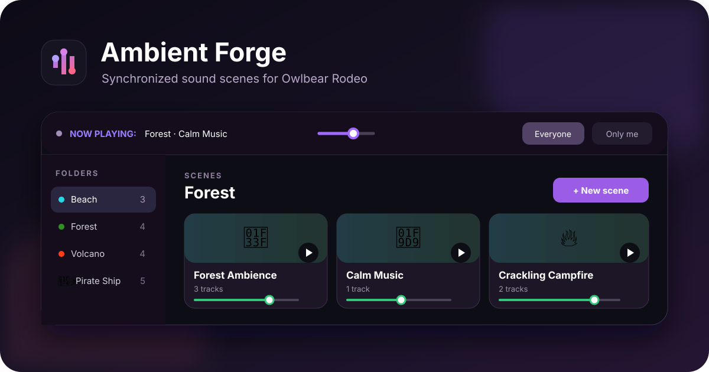

# Ambient Forge



Ambient Forge is an open-source sound scene mixer for [Owlbear Rodeo](https://www.owlbear.rodeo/). Build layered scenes from music, ambience, voices, and effects, then keep playback synchronized with everyone at your table.

Review build: **0.1.11** — playback lifecycle fixes, random launch, status feedback, and buffered seamless loops. See `AUDIT_RU.md` and `INSTALL_RU.md`.

## Install

This fork is maintained by [opnmn-v](https://github.com/opnmn-v) and hosted on GitHub Pages. In Owlbear Rodeo, open Extensions, choose to add a custom extension, and paste this manifest URL:

```text
https://opnmn-v.github.io/aduioforge_pewpew/manifest.json
```

The Pages deployment must serve the extension's `manifest.json` at that address, with application and asset URLs configured for the `/aduioforge_pewpew/` path. Publishing the repository's README alone does not install the extension.

## GitHub Pages deployment

The `Deploy GitHub Pages` workflow tests and builds the app, then publishes `dist`. In repository Settings → Pages, set Source to **GitHub Actions**. Pushes to `main` deploy automatically; the workflow can also be run from the Actions tab.

## Features

- Layer multiple tracks in a single sound scene.
- Launch one random scene from a folder, or one random unmuted track from a scene.
- Enable Seamless loop for short direct audio files (up to 120 sec / 12 MiB; CORS required).
- Organize scenes into colored folders with custom emoji icons.
- Play direct MP3, OGG, WAV, and YouTube sources.
- Paste public Dropbox share links without manually changing their URL parameters.
- Control master, scene, and individual track volume.
- Pause and resume without restarting a scene.
- Configure looping, randomized repeat delays, fade in, and fade out.
- Synchronize playback with the room or keep it private to the game master.
- Import and export complete libraries as `.aforge` files.
- Import compatible Djinni music-player libraries.
- Keep audio playing while the extension popover is closed.

## Development

Requirements: Node.js 22.12 or newer.

```bash
npm install
npm run dev
```

Add `http://localhost:5173/aduioforge_pewpew/manifest.json` as a custom extension. For a standalone visual preview, open `http://localhost:5173/aduioforge_pewpew/?preview=1`.

Create a production build with:

```bash
npm run build
```

## Data and privacy

Ambient Forge stores your sound library locally in the browser. Use **Export** to make a portable backup before clearing browser data or moving to another device. Room playback state is shared only as needed to synchronize audio in Owlbear Rodeo.

## Support and contributions

Report bugs or suggest features for this fork in [GitHub Issues](https://github.com/opnmn-v/aduioforge_pewpew/issues). Pull requests are welcome.

## License

This fork is maintained by **opnmn-v**. The original Ambient Forge project is by **Marevo** and released under the [MIT License](LICENSE); the original copyright notice is preserved.
